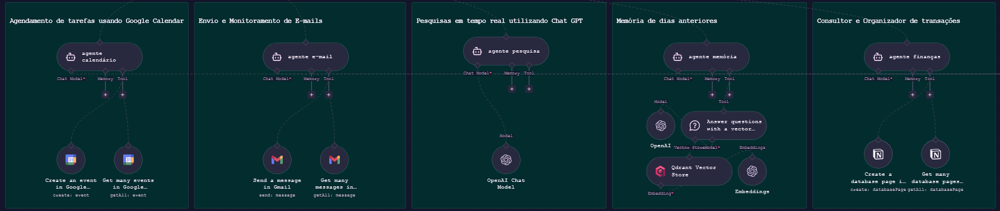
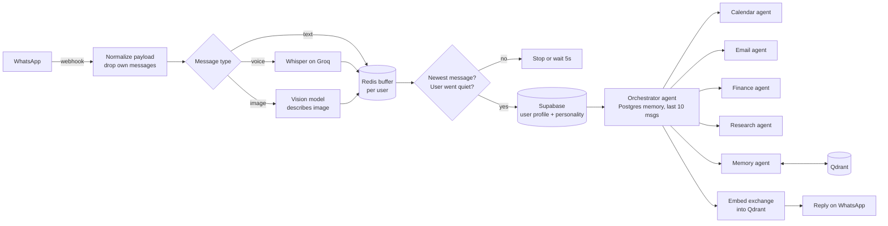
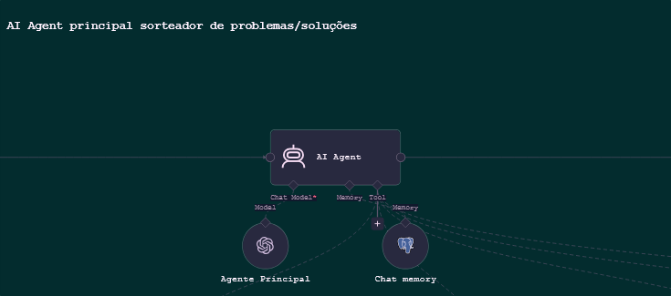

# Alfred: a multi-agent personal assistant on WhatsApp

A personal assistant that lives in one WhatsApp chat. It schedules events, reads and sends email, logs and analyzes my spending, searches the web, and remembers past conversations. It accepts text, voice notes and images.

I built it as my capstone project (Systems Analysis and Development, FATEC Botucatu, 2026) to solve my own problem. My routine and money were spread across five places: Gemini for questions, Nubank for spending, a WhatsApp group with only myself for notes, Gmail and Google Calendar. Now they're one conversation.

**Stack:** n8n · Evolution API (WhatsApp) · OpenAI `gpt-5-mini` · Whisper `whisper-large-v3-turbo` on Groq · Redis · Supabase · Postgres · Qdrant · OpenAI `text-embedding-3-small` · Google Calendar, Gmail and Notion APIs

## How it works

1. **Intake.** The Evolution API sends every WhatsApp event to an n8n webhook. A Code node keeps only new messages, drops the bot's own messages to prevent echo loops, and routes by type. Voice notes are transcribed with Whisper, and images are described by a vision model, so everything after this point is text.
2. **Message buffer.** People send several short messages in a row. Each message is pushed to a Redis list keyed by the user. Every execution checks whether its message is still the newest in the list: if not, it stops, because a newer execution will take over. The last one waits until the user goes quiet, reads the whole list, clears it and continues. A burst of messages becomes one input and one reply.
3. **User profile.** The user's name, phone and the assistant's personality prompt are loaded from Supabase. The same workflow can serve several people, each with their own assistant.
4. **Orchestrator + specialists.** A main agent reads the request and delegates to five specialist agents, each exposed to it as a tool:

| Agent | Tools | What it does |
|---|---|---|
| Calendar | Google Calendar (create, list) | Turns "tomorrow afternoon" or "next week" into exact ISO dates in São Paulo time before scheduling |
| Email | Gmail (send, list) | Summarizes the inbox into what matters; writes emails in the tone the user asks for |
| Finance | Notion database (create, query) | Logs transactions with category, payment method, account and status restricted to fixed options, so the model can't invent values. For questions like "how much did I spend last month?", it computes the date range, queries and summarizes by category |
| Research | OpenAI built-in web search | Current information, docs, news, prices |
| Memory | Qdrant vector store | Retrieves past conversations; answers "I couldn't find anything" instead of guessing |

5. **Long-term memory.** After every reply, the exchange (user message + assistant reply) is embedded and stored in Qdrant, tagged with the user's phone number. The memory agent filters by that tag, so one user's history never shows up for another user.

## Design decisions

- **Orchestrator + narrow specialists instead of one agent.** My first prototype was a single agent with every tool and every instruction. It mixed tasks up and kept making mistakes. Splitting the work so each agent has a short prompt and only its own tools made the results much more reliable, and it makes each agent easier to debug alone.
- **Fixed options for structured writes.** The finance agent fills Notion select fields only from predefined lists. Free text there would have broken every monthly summary.
- **Everything becomes text early.** Transcribing audio and describing images at intake means the agents only ever deal with text, which keeps them simpler.
- **Memory scoped per user at query time,** not only by convention in the prompt.

## Testing

I used it daily myself, and I created separate profiles for three other people as test users, each with their own personality and memory. All three were satisfied with it. For the capstone presentation I scaled it back to a single user.

## Running it

This is an n8n export, so it doesn't run straight from the repo: credentials are never included in n8n exports. To run your own copy:

1. Import `workflow/assistente-pessoal.json` into n8n (tested on n8n 2.x).
2. Create credentials for OpenAI, Redis, Postgres, Supabase, Qdrant, Google Calendar, Gmail and Notion, and attach them to the matching nodes.
3. Replace the placeholders: `<EVOLUTION_API_URL>`, `<EVOLUTION_API_KEY>`, `<GROQ_API_KEY>` and `<NOTION_DATABASE_ID>`. In production these should live in n8n credentials (Header Auth), not in node parameters.
4. Create the Supabase table `Personalidades dos Assistentes` with the columns `telefone_dono`, `nome_dono` and `personalidade_assistente` (the system prompt). The `Switch1` node routes by `nome_dono`, so change its value to your name.
5. Create a Notion database with the properties `Tipo`, `Categoria`, `Data`, `Valor`, `Forma de Pagamento`, `Conta/Cartão` and `Status`, using the select options listed in the `Create a database page in Notion` node.
6. Create a Qdrant collection `memoria_assistente` sized for `text-embedding-3-small` (1536 dimensions).
7. Point your Evolution API instance's webhook (`messages.upsert`) to the n8n webhook path `/assistentepessoal`.

Prompts and node names are in Portuguese, because the assistant was built for Portuguese speakers.

## What I'd do next

- Move every key into n8n credentials and add an error workflow with alerts.
- Add a fixed test set of conversations per agent and run it after every prompt change.
- Track latency and cost per message.
